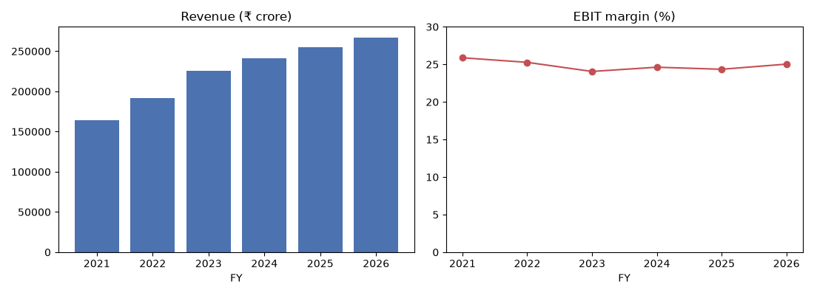
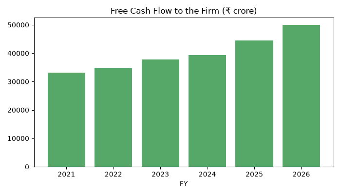
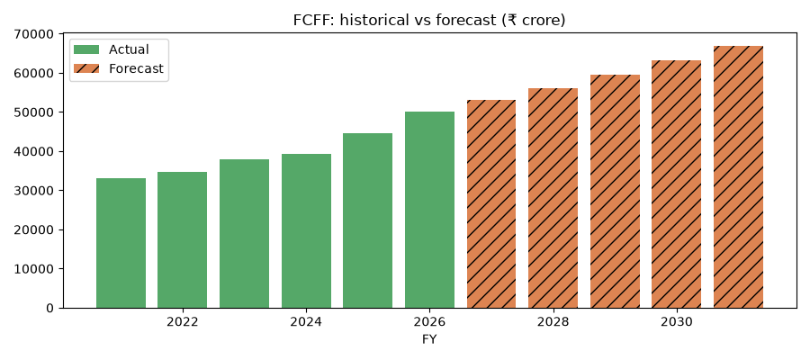
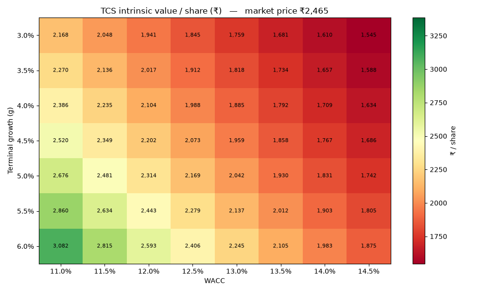
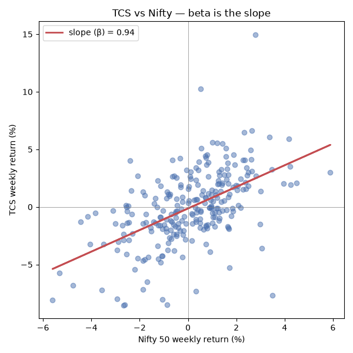

# TCS DCF Valuation — Python *(built with AI assistance)*

A discounted cash flow (DCF) model that estimates the intrinsic value of **Tata Consultancy Services (TCS.NS)** and judges whether the stock is over- or under-valued versus its live market price. Built in Python as a hands-on application of corporate finance fundamentals.

> **On AI usage — stated upfront.** This project was built with the help of Claude (Anthropic) as a coding assistant. The **financial reasoning, every assumption, and every analytical decision are my own**; the AI assisted with Python syntax and structure — I directed what to build and why, and can explain and defend every line and number. I'm disclosing this deliberately: the goal was to *learn by building*, and owning the logic mattered more than typing it unaided.

**Headline result:** On deliberately conservative assumptions, TCS's intrinsic value works out to **~₹2,113/share against a market price of ₹2,465 — about 14% overvalued.** A sensitivity analysis shows the stock only looks cheap under a sub-11.5% WACC combined with 5%+ perpetual growth.

---

## What the model does

1. Pulls **6 years of financials** (FY2021–FY2026) from TCS's annual reports / Screener.in
2. Builds **historical free cash flow to the firm (FCFF)** from first principles
3. Forecasts FCFF **5 years forward** on a defensible growth assumption
4. Estimates **WACC**, including a **self-computed beta** regressed against the Nifty 50
5. Discounts the cash flows + a **Gordon-growth terminal value** to an **intrinsic value per share**
6. Produces a **WACC × terminal-growth sensitivity heatmap** to show the full range, not a single fragile point

Live market price is pulled automatically via \`yfinance\`; every financial assumption is sourced manually and documented below.

---

## Key assumptions

| Input | Value | Basis |
|---|---|---|
| Explicit FCFF growth (FY27–31) | 6% | Below the ~8.5% historical FCF CAGR (which was flattered by margin/tax tailwinds now spent); above the ~5% recent revenue growth |
| Terminal growth (g) | 5% | ≈ long-run nominal GDP/inflation; below WACC and below the explicit rate |
| Risk-free rate (Rf) | 7.15% | 10-year Government of India G-sec yield |
| Beta (β) | 0.938 | Own regression: 5y weekly TCS returns vs Nifty 50 |
| Equity risk premium | 6% | Indian large-cap (≈ Damodaran, mildly conservative) |
| Cost of debt (pre-tax) | 7.5% | TCS ≈ AAA issuer; Rf + thin spread |
| WACC | 12.71% | ≈ cost of equity, since TCS is ~99% equity-funded |
| Net cash | ~₹55,000 cr *(estimate — refine from balance sheet)* | Cash + investments − total debt |

---

## Historical financials — revenue growth vs margin stability

Revenue grew steadily but decelerated sharply (16.8% → 4.6%), while EBIT margin held rock-steady around 24–25% through the cycle. Stable margins are what make forecasting profit as a % of revenue defensible.

## Historical free cash flow (FCFF)

Despite slowing revenue, free cash flow compounded ~8.5% a year — a signature of an asset-light business converting ~90–100% of operating profit into cash.

## Forecast FCFF

FCFF projected 5 years forward at 6% (orange), handing off smoothly from the historical series (green).

---

## Headline outputs

| Metric | Value |
|---|---|
| Sum PV of explicit FCFF | ₹208,728 cr |
| PV of terminal value | ₹500,738 cr (71% of EV) |
| Enterprise value | ₹709,466 cr |
| Equity value | ₹764,466 cr |
| **Intrinsic value / share** | **₹2,113** |
| Live market price | ₹2,465 |
| **Verdict** | **~14% overvalued** |

Terminal value is **71% of enterprise value** — a reminder that most of any DCF rests on the terminal assumption, which is why the sensitivity analysis matters.

---

## Sensitivity analysis

Intrinsic value per share across a grid of WACC and terminal growth. Green = undervalued vs market; red = overvalued. TCS only prices as cheap in the top-left (low WACC, high growth); across most reasonable assumptions it is fair-to-overvalued.

**Reading it:** at a 5% terminal growth rate, the ₹2,465 market price implies a WACC near 11.6% — i.e. the market is pricing TCS as ~110 bps less risky (or faster-growing) than this model's base case.

---

## Beta — computed, not copied

Beta was estimated by regressing 5 years of weekly TCS returns against the Nifty 50, rather than pulling a vendor figure, so the methodology is fully owned. The cov/var definition and the OLS regression slope agree at **0.938** — a defensive sub-1 beta, as expected for a large-cap IT services firm.

---

## A few deliberate analytical choices

- **EBIT, not EBITDA.** Screener's "Operating Profit" row is pre-depreciation (EBITDA); EBIT is derived as Operating Profit − Depreciation, so depreciation isn't double-counted in the FCFF bridge.
- **Working-capital sign.** The cash flow statement already reports working-capital movements as a cash effect, so the figure is added with its own sign rather than blindly subtracted.
- **Non-operating income excluded.** TCS's treasury/other income is left out of FCFF (it isn't operating); the corresponding cash pile is instead credited back in the equity bridge as net cash.
- **Terminal value from first principles.** The Gordon formula is used as the closed form of a growing perpetuity (a geometric series converging because g < WACC).

---

## How to run

\`\`\`bash
pip install yfinance pandas numpy matplotlib
python dcf_tcs.py
\`\`\`

Python 3.14. The script prints each stage's table to the console and opens the charts.

## Data sources

- Financial statements: TCS annual reports / Screener.in (consolidated)
- Live price & market cap: \`yfinance\`
- Risk-free rate: 10-year Government of India bond yield
- Market index for beta: Nifty 50 (\`^NSEI\`)

## Disclaimer

Educational project built to apply corporate finance concepts. Not investment advice. All assumptions are the author's own and deliberately simplified.

---

**Author:** Harsh Trivedi
